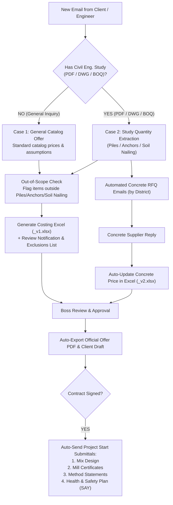

# IMPLEMENTATION PLAN — NIKOLAS TRY

> **Last Updated:** 2026-10-27
> **Scope:**
> 1. Cross-PC Workspace & Agent Memory Sync Bridge (`.agent-memory/` + Git)
> 2. 5-Stage Automated Geotechnical Costing & Workflow Pipeline (ΘΕΜΕΛΙΟΤΕΧΝΙΚΗ ΛΤΔ)

---

## Part A: Cross-PC Workspace & Context Sync Bridge (Active Implementation)

### Objective
Share the `NIKOLAS TRY` workspace—including all rules, Python engines, project files, and ongoing AI context/plans/tasks—between PC 1 and PC 2 **without** syncing the global `~/.gemini` history from unrelated projects.

### Architecture
1. **Project-Local Memory (`.agent-memory/`):**
   - `PROJECT_STATE.md`: Single source of truth for workspace structure, active rule versions (`ACTIVE_VERSION.json`), and architectural decisions.
   - `TASKS.md`: Live checklist of completed work and pending tasks across sessions.
   - `IMPLEMENTATION_PLAN.md`: Current technical roadmap and active implementation specifications.
   - `WALKTHROUGH.md`: Latest session summary and verification history.
2. **Automatic Rule Enforcement:**
   - Root rule files (`.antigravityrules`, `.gemini/GEMINI.md`, `GEMINI.md`, and `.agents/rules/agent-memory-sync.md`) instruct Antigravity to:
     - Always read `.agent-memory/PROJECT_STATE.md` and `.agent-memory/TASKS.md` at the start of every session.
     - Automatically update `.agent-memory/` files whenever a task completes, architecture changes, or before a session ends.
3. **Helper Scripts (`sync_push.bat` & `sync_pull.bat`):**
   - `sync_push.bat`:
     - Scans `%USERPROFILE%\.gemini\antigravity\brain\` for the latest session's `task.md`, `implementation_plan.md`, and `walkthrough.md` (if modified recently) and copies them into `.agent-memory/`.
     - Stages all changes in `NIKOLAS TRY` (`git add -A`), commits with a timestamp, and pushes to the remote Git repository (`git push`).
   - `sync_pull.bat`:
     - Pulls the latest changes from the remote Git repository (`git pull --rebase --autostash`).
     - Displays the latest `.agent-memory/` status so PC 2 is immediately ready.

---

## Part B: 5-Stage Automated Geotechnical Costing Pipeline (Master Plan)

Copied and maintained from the session plan (`master_plan_kostologiseis.md`):

### Stage Breakdown
1. **Stage 1 — Automated Email Reading & Costing Generation:**
   - Scan Outlook inbox for quotation requests.
   - Route to Bored Piles (`pile_engine_v7.py`), Anchors (`Κανονες_Αγκυρωσεων` `v8`), or Soil Nailing (`Κανονες_Εδαφοηλωσεων` `v8`).
   - Distinguish Case A (General Price without study) vs. Case B (Full study extraction into 3-Sheet Excel under `Projects/`).
   - Explicitly flag any out-of-scope works requested by the client.
2. **Stage 2 — Automated Concrete Price RFQs by District:**
   - Maintain district supplier directory (Limassol, Larnaca, Nicosia, Paphos, Famagusta) and auto-prepare concrete quote emails with project reference codes.
3. **Stage 3 — Concrete Quote Ingestion & `_v2.xlsx` Update:**
   - Parse supplier responses (`€/m³`) and generate `_v2.xlsx` with updated concrete pricing on Sheet 3 (`Τιμές & Έλεγχος`).
4. **Stage 4 — Boss Review & PDF Offer Generation:**
   - Convert Sheet 1 (`Οικονομική Προσφορά`) into an official PDF offer and draft the client response email.
5. **Stage 5 — Post-Contract Submittals:**
   - Automatically dispatch requests/documents for Mix Design, Mill Certificates, Method Statements, and ΣΑΥ upon contract approval.
